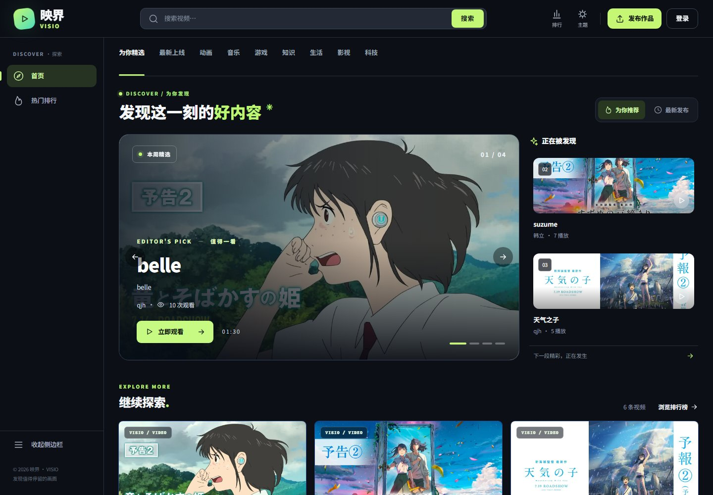
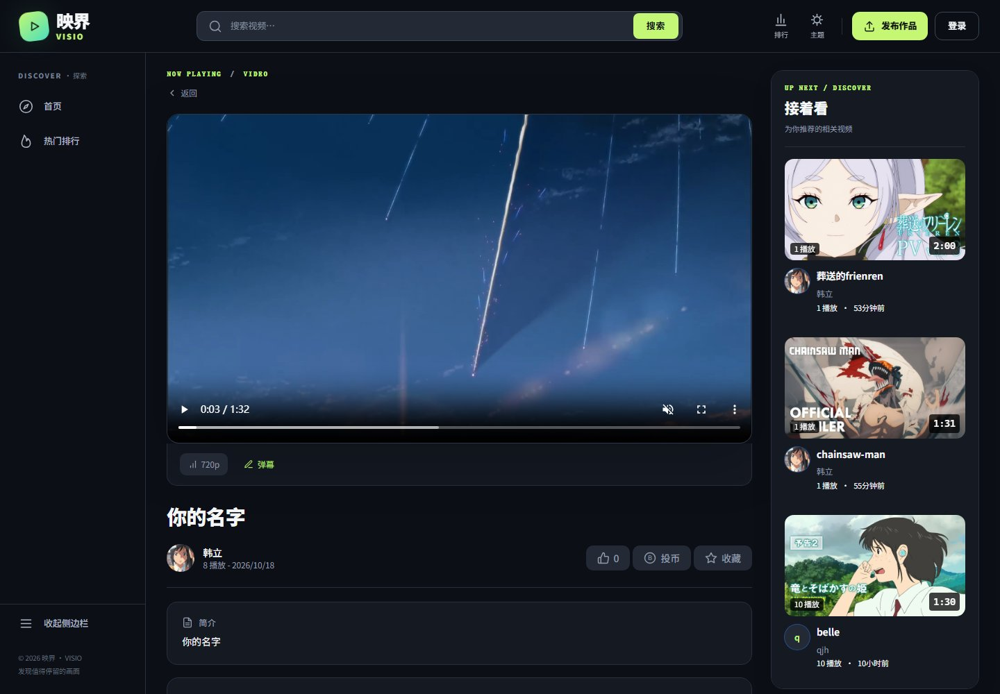
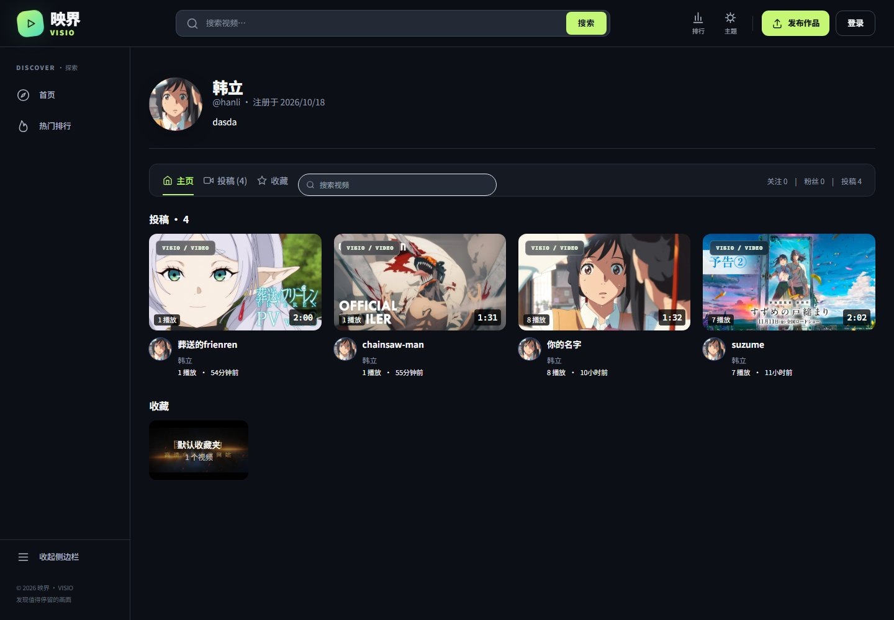
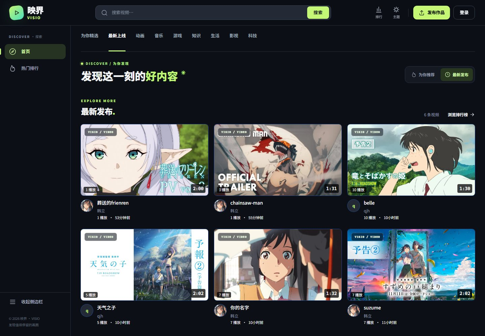
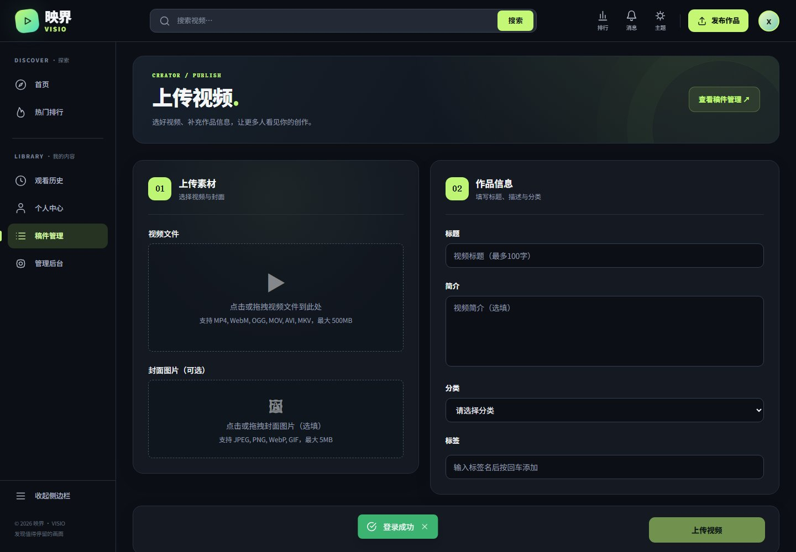
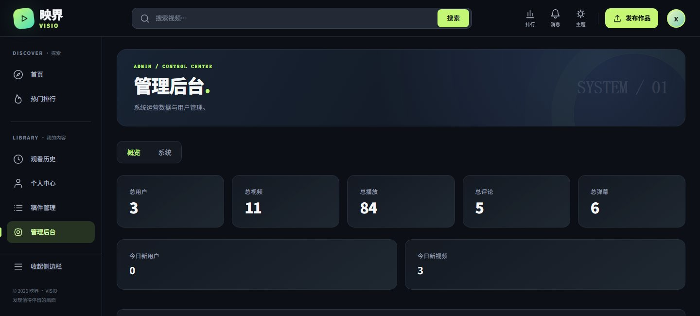

# 映界 · Xilixili

基于 Go 和 Nuxt 的视频社区，支持视频投稿、异步转码、多清晰度播放、实时弹幕、评论回复与收藏夹。前端采用深浅双主题，后端使用 Gin + GORM，统一通过 Nginx 提供 HTTPS 访问。

## 界面预览

### 首页



### 视频播放



### 个人中心



<details>
<summary>最新上线、视频投稿与管理后台</summary>







</details>

## 功能

- 账号：注册登录、个人资料、头像上传、关注与粉丝。
- 浏览：分类、关键词搜索、搜索建议、热门推荐、日榜 / 周榜 / 总榜。
- 投稿：视频与封面上传、上传进度、草稿编辑、转码状态、发布与删除。
- 播放：HLS、多清晰度切换、弹幕开关、观看进度与历史记录。
- 互动：点赞、投币、收藏夹、评论、楼中楼回复与评论点赞。
- 消息：评论回复、点赞及关注通知，支持未读计数与已读操作。
- 管理：数据概览、用户管理、角色调整、视频审核与系统状态。

## 技术栈

| 模块 | 技术 |
| --- | --- |
| 前端 | Nuxt 4、Vue 3、TypeScript、Pinia、Tailwind CSS |
| 播放器 | Video.js、HLS.js |
| 后端 | Go 1.25、Gin、GORM、JWT |
| 数据与缓存 | MySQL 8、Redis 7 |
| 视频处理 | RabbitMQ、FFmpeg、ffprobe、MinIO |
| 部署 | Docker Compose、Nginx |

## 快速启动

安装并启动 Docker Desktop，使用 Linux 容器模式。前后端及依赖服务均在容器内构建运行。

### 1. 配置环境

在项目根目录执行：

```powershell
Copy-Item .env.example .env
notepad .env
```

填写 MySQL、MinIO、RabbitMQ 的账号密码和 `JWT_SECRET`。MinIO 的 `MINIO_ACCESS_KEY` / `MINIO_SECRET_KEY` 分别与 `MINIO_ROOT_USER` / `MINIO_ROOT_PASSWORD` 保持一致。

### 2. 启动

```powershell
powershell -NoProfile -ExecutionPolicy Bypass -File .\start.ps1
```

启动脚本构建镜像、创建服务并检查首页和分类接口。数据库表、基础分类及存储桶在首次启动时初始化。

| 服务 | 地址 |
| --- | --- |
| 网站 | https://localhost:8443 |
| HTTP 入口 | http://localhost:8088，跳转至 HTTPS |
| MinIO 控制台 | http://localhost:9001 |
| RabbitMQ 管理台 | http://localhost:15672 |

本地 HTTPS 使用自签名证书，首次访问时在浏览器中继续访问即可。

### 3. 停止与日志

```powershell
# 停止服务，保留数据库和视频文件
powershell -NoProfile -ExecutionPolicy Bypass -File .\stop.ps1

# 查看服务状态
docker compose ps

# 查看后端日志
docker compose logs -f --tail 100 backend
```

Linux / macOS 使用相同的 Compose 配置：

```bash
cp .env.example .env
# 编辑 .env 后启动
docker compose up -d --build --wait --wait-timeout 180
docker compose stop
```

镜像下载较慢时，可先准备基础镜像，再运行启动脚本：

```powershell
powershell -NoProfile -ExecutionPolicy Bypass -File .\tools\get-images.ps1
```

### 管理员账号

先通过网页注册账号，再进入数据库设置角色：

```bash
docker compose exec mysql sh -c 'exec mysql -u"$MYSQL_USER" -p "$MYSQL_DATABASE"'
```

输入 `.env` 中的 `MYSQL_PASSWORD`，执行：

```sql
UPDATE users SET role = 3 WHERE username = 'your_username';
```

重新登录后，侧栏和头像菜单会出现「管理后台」入口。

## 项目结构

```text
Xilixili/
├── backend/
│   ├── cmd/server/       # 服务入口与依赖装配
│   ├── internal/
│   │   ├── handler/      # HTTP 接口
│   │   ├── service/      # 业务逻辑
│   │   ├── repository/   # 数据访问
│   │   ├── model/        # 数据模型与响应结构
│   │   ├── middleware/   # 认证、CSRF、限流
│   │   └── worker/       # 异步转码任务
│   ├── pkg/              # 配置、存储、日志等公共组件
│   └── migrations/       # 数据库初始化 SQL
├── frontend/
│   ├── pages/            # 页面与路由
│   ├── components/       # 播放器、评论、弹幕及通用组件
│   ├── composables/      # API 请求与公共逻辑
│   ├── stores/           # 用户与主题状态
│   └── tests/            # 前端回归与接口检查
├── minio/                # MinIO 和 mc 镜像构建
├── nginx/                # HTTPS、反向代理、SSE / WebSocket 转发
├── screenshots/          # 页面截图
├── tools/get-images.ps1  # 基础镜像获取
├── docker-compose.yml
├── .env.example
├── start.ps1
└── stop.ps1
```

## 视频处理

```text
浏览器上传 -> Go API -> MinIO 原文件
                    -> RabbitMQ -> FFmpeg 转码 -> MinIO HLS
浏览器播放 <- 播放地址接口 <----------------------+
```

上传接口通过 SSE 返回进度。转码任务由 RabbitMQ 分发，FFmpeg 生成 HLS 文件和可用清晰度；稿件管理页面持续查询转码状态。

## 测试

前端包含评论计数、稿件轮询、收藏交互、排行榜竞态及个人中心布局等回归检查。执行方式见 [前端测试说明](frontend/tests/README.md)。

```powershell
node .\frontend\tests\comment-count.cjs
node .\frontend\tests\draft-transcode.cjs
node .\frontend\tests\profile-videos.cjs
node .\frontend\tests\ranking-race.cjs
```
